# Q-VLP — Quantum-based Location Estimation

Q-VLP is an Android research app for **Quantum-based Location Estimation** using visible-light positioning. It has two modes. **Data Collection Mode** records frames of the ceiling LEDs at numbered positions, detects the LEDs in every frame and builds the fingerprint file `final.csv`. **Inference Mode** runs two models on the camera preview: the **Physical LED Detection Model** finds each LED and the **OOK-Based LED Recognition Model** names it. The app draws a box round each LED and, for each captured position, saves the frames with those boxes together with `final.csv`. Location estimation is planned.

The app is derived from [RoTemplate](https://github.com/denizkarya1999/RoTemplate). Open this directory in Android Studio; `app` is the application module.

- App name: Q-VLP
- Application ID and namespace: `com.developer27.qvlp`
- Version: 1.3.1
- Release date: November 16, 2026
- Source template: [RoTemplate](https://github.com/denizkarya1999/RoTemplate)

**Topics:** `android` · `kotlin` · `camera2` · `pytorch` · `yolo` · `resnet` · `visible-light-positioning` · `indoor-positioning` · `location-estimation` · `quantum-based-localization` · `manual-camera-controls`

## Authors

Thuy-Anh Nguyen, Shahed Alabdulrahman, Deniz Karya Acikbas, Christian Nwobu, Clark Friese, and Ethan Liu.

Professor: Xiao Zhang · [Trustworthy AIoT Lab](https://www.zhangxiao.me/) · University of Michigan-Dearborn.

## Screenshots

Taken on a Pixel 8a. The files are in [`screenshots/`](screenshots), numbered in the order below.

| | | |
|:---:|:---:|:---:|
| 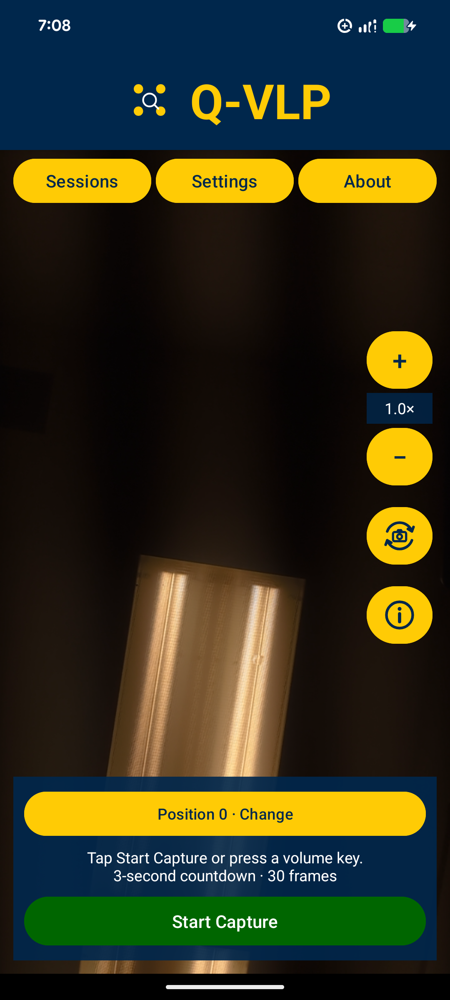 | 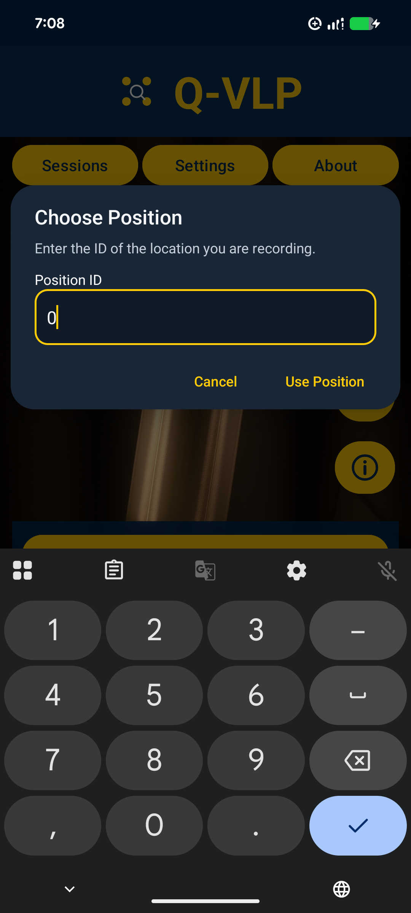 | 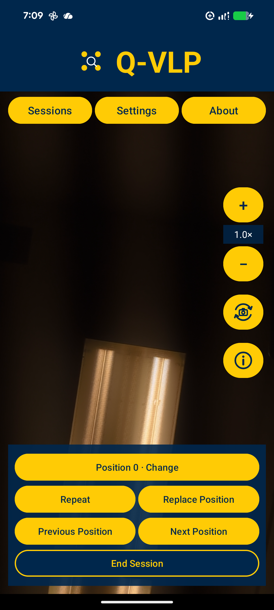 |
| 1. Camera screen | 2. Entering the position ID | 3. After a capture |
| 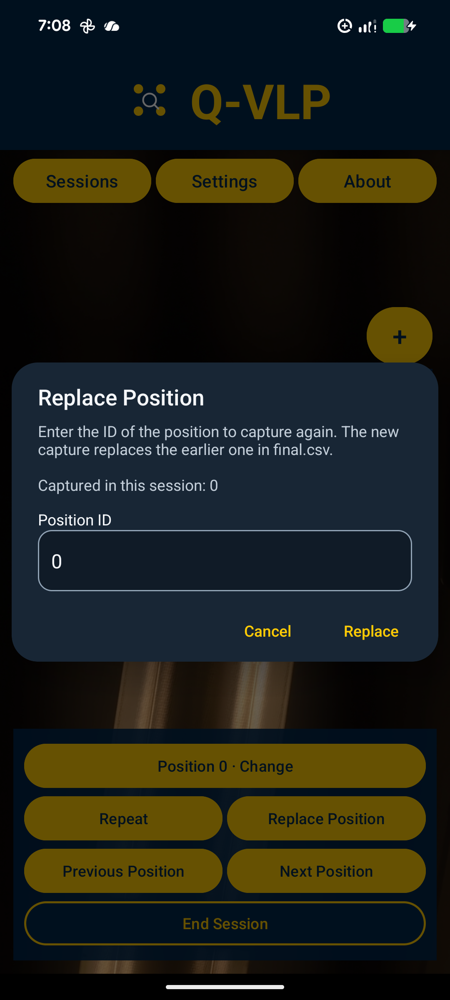 | 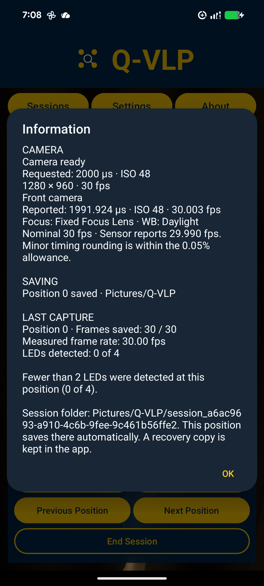 | 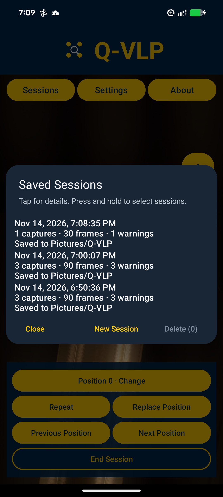 |
| 4. Replace Position | 5. Information | 6. Sessions |
| 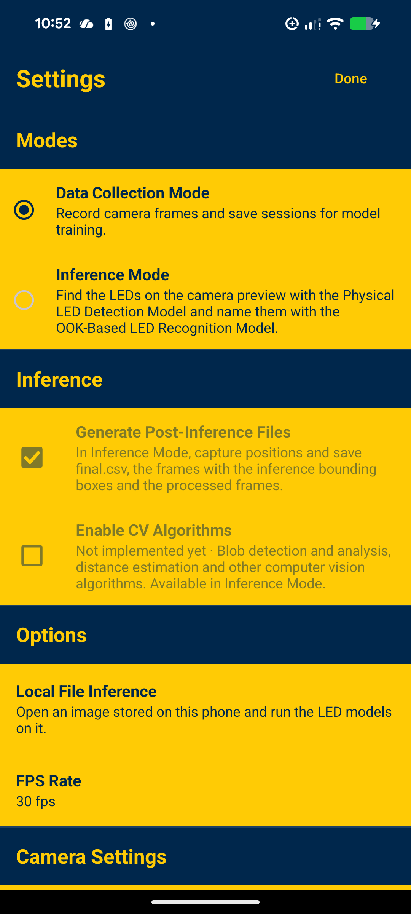 | 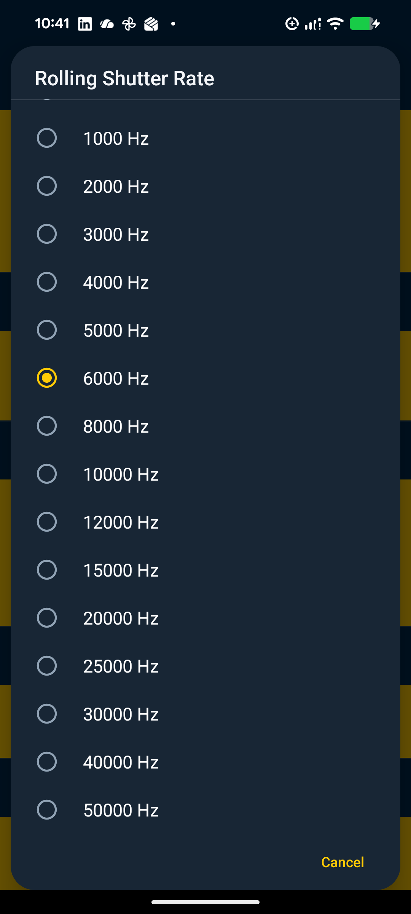 | 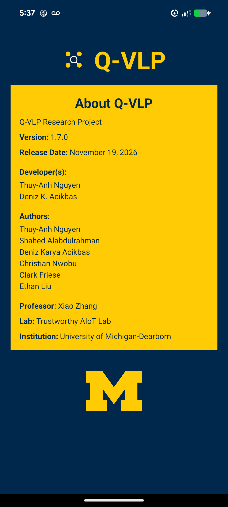 |
| 7. Settings | 8. Rolling Shutter Rate | 9. About |
| 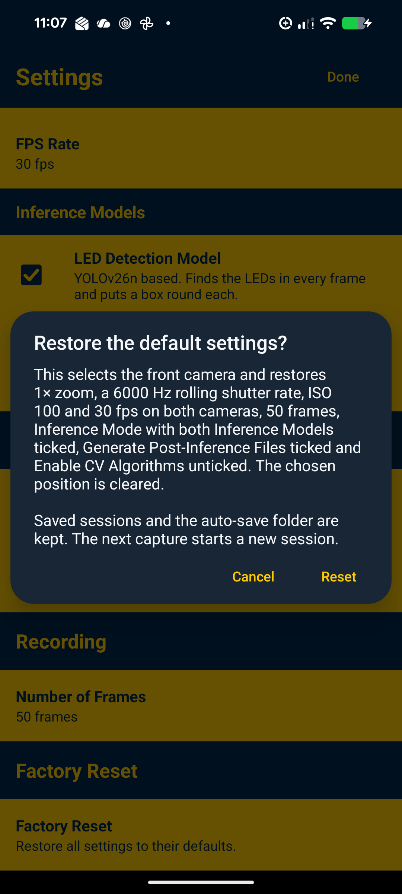 | 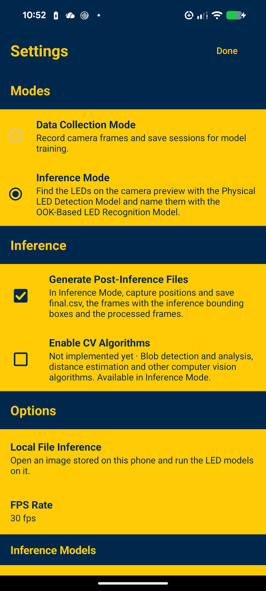 | 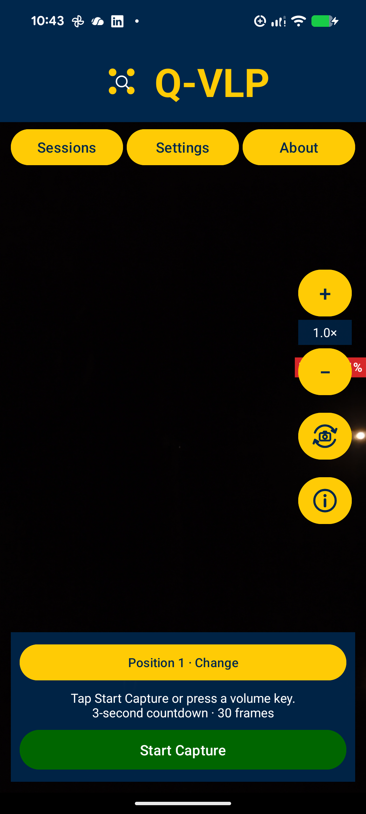 |
| 10. Factory Reset | 11. Settings in Inference Mode | 12. Inference Mode |
| 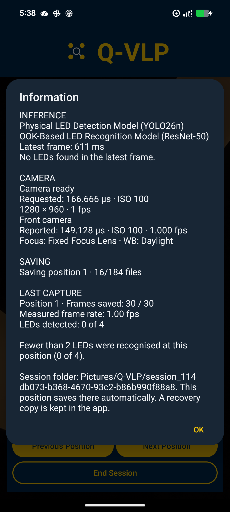 | 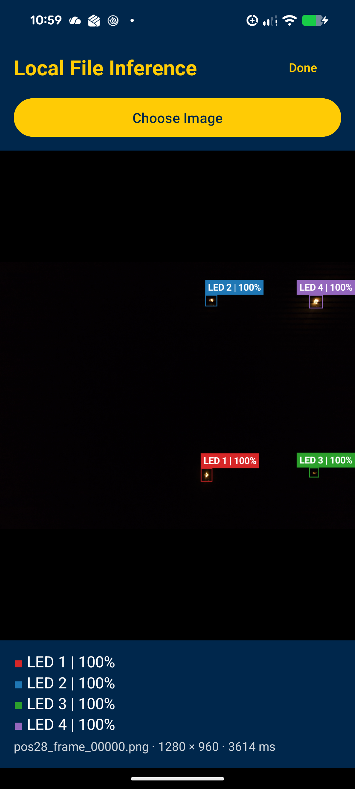 | 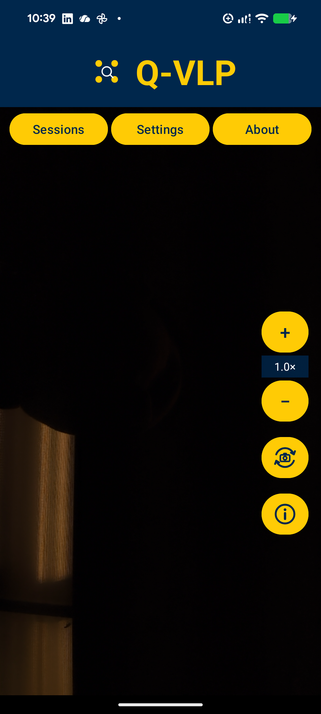 |
| 13. Information in Inference Mode | 14. Local File Inference | 15. Inference Mode without post-inference files |
| 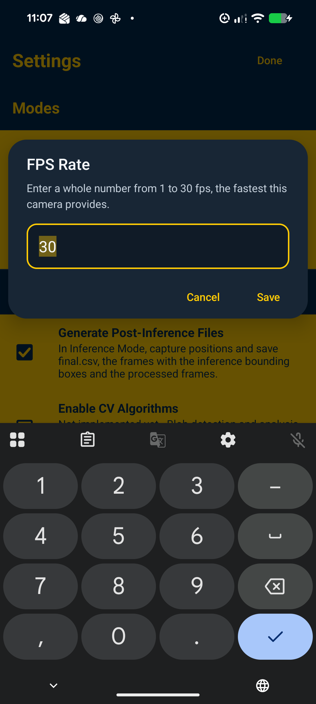 | 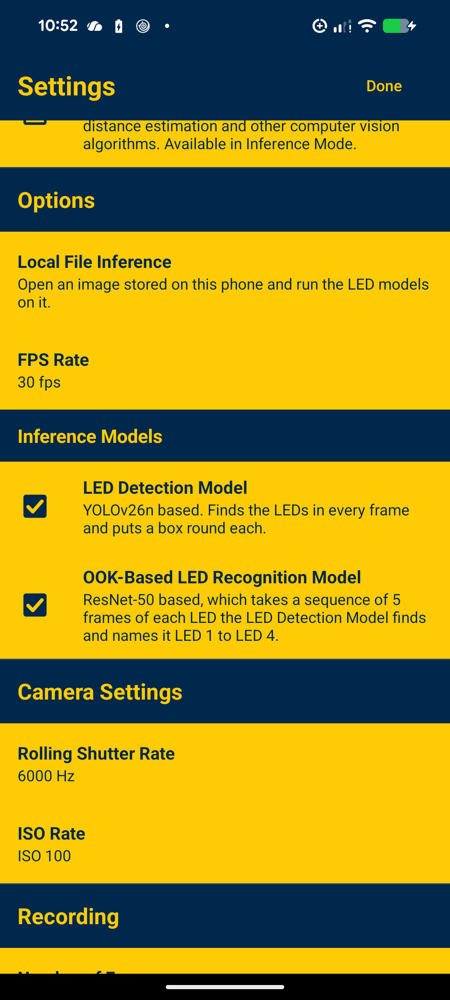 | |
| 16. FPS Rate | 17. Inference Models | |

No LEDs were in front of the camera when screenshots 12, 13 and 15 were taken, so they show no boxes. Screenshot 14 shows the boxes and tags on a test frame of the third session; the preview draws them the same way.

## Using Q-VLP

**Settings** has six sections. **Modes** is two radio buttons: **Data Collection Mode** runs the recording workflow below; **Inference Mode**, selected on a new installation, adds the two LED models (see [Inference Mode](#inference-mode)). **Inference** has two checkboxes that can be changed while Inference Mode is selected: **Generate Post-Inference Files** and **Enable CV Algorithms**. **Options** has **Local File Inference** and **FPS Rate** and, while Inference Mode is selected, **Inference Models**: two checkboxes, **LED Detection Model** and **OOK-Based LED Recognition Model** (see [Inference Models](#inference-models)). **Camera Settings** has **Rolling Shutter Rate** and **ISO Rate**. **Recording** has **Number of Frames**. **Factory Reset** has the **Factory Reset** button. There is no Help section.

1. Tap **Position** and enter the position ID. Only the ID is typed: there are no X/Y coordinates and no list to import.
2. Mount the phone with the camera lens over the mark, at the same height for every position.
3. Align the ceiling LEDs in the preview and tap **Start Capture** (or press a volume key), then step away. The app waits 3 seconds, captures **Settings → Recording → Number of Frames** frames (1–1000, default 50) at the **FPS Rate** (default 30 fps, so 50 frames take under two seconds), and processes them. There is no beep or vibration.
4. When processing ends, the buttons below replace Start Capture. Nothing is written on the result screen: no result line, no warning line and no status boxes.

   | | |
   |---|---|
   | **Repeat** | **Replace Position** |
   | **Previous Position** | **Next Position** |
   | **End Session** | |

   - **Repeat** captures the same position again.
   - **Next Position** and **Previous Position** select the next or previous position (ID ± 1). Capturing a position that already has a capture replaces it.
   - **Replace Position** asks for the ID of the position to capture again. It lists the IDs captured in this session and rejects an ID that has no capture.
   - **End Session** can be tapped after any position. Captured positions stay saved, and the next capture starts a new session.

   "Replace" means the latest completed capture of a position is the one used in `final.csv`. The earlier capture's folders are kept in the session.
5. The app creates **Internal storage/Pictures/Q-VLP** by itself when it starts (Android 11 and later). Once, choose where sessions are saved: when auto-save needs setting up, a notice appears on the camera screen; tap it, then **Choose folder → Internal storage → Pictures → Use this folder → Allow**. After that every position saves to **Pictures/Q-VLP** automatically and the notice stays hidden.

### The information button

The **i** button under the camera-switch button opens everything the screen no longer shows:

- **Inference** (Inference Mode only) — the models that run, how long the latest frame took and the LEDs found in it.
- **Camera** — whether the camera is ready, and the requested and reported settings.
- **Saving** — the auto-save progress of the session folder.
- **Last capture** — frames saved, measured fps, which LEDs were detected, any warnings, and the session folder.

The camera and saving notices appear on the camera screen only when something needs attention, such as a missing permission or a failed save.

### Automatic camera reset

When the camera needs attention, the app does not wait for the operator. It resets the camera to its defaults and shows a short **Camera reset to default.** message:

1. The camera in use goes back to 1× zoom, a 6000 Hz rolling shutter rate, ISO 100 and 30 fps, and is reopened.
2. If that camera still needs attention, the app switches to its default camera, the front one, with the same defaults.
3. Only a problem that survives both is shown as **Camera needs attention**. Tap it for the details.

Capture needs 1× zoom, so zooming in is one of these cases: the preview zooms for a moment and the camera then returns to 1×. A problem a camera reports only while it is settling is given three seconds to clear before anything is reset, and nothing is reset during a countdown or capture. A reset starts a new session on the next capture, as any change of camera or zoom does.

### Camera screen

**Sessions**, **Settings** and **About** are across the top; **Position** and a full-width **Start Capture** button are at the bottom. On the right of the preview, from top to bottom: **+**, the zoom level, **−**, the **switch-camera** button and the **i** button. Zoom uses the camera's digital crop range in 0.1× steps; captures are taken at 1×, and a zoomed camera resets itself (see Automatic camera reset). The app opens the **front camera** by default; the switch button's icon shows the camera a tap selects (a camera for rear, a person for front) and is hidden when the device has one facing. Each camera keeps its own settings and zoom, and switching camera or changing zoom starts a new session on the next capture.

The preview always fills the screen at the camera image's true proportions, on both cameras, and crops what does not fit; there is no preview size setting. It is display-only: it does not change zoom, resolution or saved pixels. Screen orientation is held during a capture and frames are not rotated. Cancelling or leaving the app keeps the frames already saved and marks the capture as interrupted.

**Settings → Camera Settings** has two options. **Rolling Shutter Rate** is a list in Hz, as in RoTemplate and LiFind; the exposure time is one period of the rate (6000 Hz, the default, is about 167 µs). Only rates the camera supports are listed, and every listed rate can be used for capture: choosing one never blocks the camera. The LED stripes (1.8–4.8 kHz) are sharpest at 10000 Hz or higher; slower rates give a brighter picture but blur the stripes, so fewer LEDs are detected. **ISO Rate** is typed within the camera's range; the default is 100. Everything else about the picture is fixed by the app and has no setting: the lens, the resolution (1280 × 960 on a Pixel 8a, front and rear), focus and white balance.

**Settings → Options → FPS Rate** is how many frames the camera takes each second. It is typed as a whole number from 1 to the fastest rate the camera provides at the fixed resolution (30 on a Pixel 8a, front and rear); the default is 30, or the rate nearest to it that the camera provides. The rate applies to the preview and to captures alike. At the default a 50-frame capture takes under two seconds; at 1 fps the preview is renewed once a second and the same capture takes 50 seconds. Every rate in the range can be used for capture: choosing one never blocks the camera. An exposure cannot be longer than a frame, so the slowest rolling shutter rates are listed only at slow FPS rates, and raising the FPS rate shortens an exposure that no longer fits. Each camera keeps its own FPS rate.

## Inference Mode

Inference Mode is the mode of a new installation; it is chosen under **Settings → Modes**. The camera screen is the same as in Data Collection Mode, and two models run on the preview, one after the other. The **Physical LED Detection Model** finds the LEDs in the frame. The **OOK-Based LED Recognition Model** then names each of them from the on-off keying (OOK) signal it sends. Every named LED gets a box in that LED's colour (LED 1 red, LED 2 blue, LED 3 green, LED 4 purple) with a tag such as `LED 1 | 98%`: the LED's name and how sure the recognition model is of it. An LED that was found but not named gets a grey box tagged `LED Detected | 93%`, with the detection model's confidence. Nothing else is written on the screen; the **i** button has the details.

- **One box per LED.** The detection model answers with thousands of candidate boxes. The app keeps at most four, one for each LED of the rig, and never two on the same light: the most confident candidates win, and a candidate that overlaps a box already kept is dropped. A candidate the model is less than 25% sure of is not an LED. No two boxes get the same name either: when the recognition model gives two lights the same name, the one it is surest of keeps it and the other stays `LED Detected`. So does an LED whose name the recognition model is less than 50% sure of.
- **Five frames per LED.** The recognition model was trained on sequences of five frames of one LED, each frame cut out along the LED's box. The app follows each LED from frame to frame (an LED is the same LED when its box overlaps the one in the frame before), keeps its last five crops, resizes each to 128 × 128 pixels and puts them side by side, the earliest on the left. An LED is named from its first frame, as five copies of that frame, and named again from every five new frames; in between it keeps the name it has. An LED that moves away, or is not found in more than five frames, starts again.
- **The models.** Both are in `app/src/main/assets` as the TorchScript exports of their training notebooks. The app loads them as they are with PyTorch (`org.pytorch:pytorch_android`), so a newly trained export can replace either file without conversion. The two files of this version were trained on the datasets of the third recording session (18 November 2026), "Physical LED Light Detection Dataset" and "OOK-Based LED Recognition Dataset", the first recorded with the LEDs' present codes. In them the LEDs are numbered by the code they send, which was read from the frames: LED 1 (`1010`) is bottom-left in a saved frame, LED 2 (`1100`) top-left, LED 3 (`1000`) bottom-right and LED 4 (`1110`) top-right. The datasets of the first two sessions numbered the LEDs by their place instead, with LED 2 bottom-right and LED 3 top-left. `qvlp_physical_led_detection_model.pt` is a YOLO26n network trained on Q-VLP frames (1280 × 960) with one class, `LED Detected`. It takes a 1 × 3 × 960 × 1280 RGB picture with values from 0 to 1 and answers with 1 × 5 × 25200 values: centre, width, height and one score for each candidate. `qvlp_ook_led_recognition_model.pt` is a ResNet-50 network. It takes N × 3 × 128 × 640 RGB strips with values from 0 to 1, one strip per LED, and answers with N × 4 probabilities, for LED 1 to LED 4. Its training classes are named after the LEDs' codes: 1010, 1100, 1000 and 1110 (see [LED transmitters](#led-transmitters)).
- **Frames.** The models are given camera frames in sensor-native orientation, converted to RGB exactly as saved frames are, which is how they were trained. The camera delivers the frames of the FPS rate, 30 a second by default. At all but the slowest rates one run takes longer than a frame, so a frame is taken whenever the models are free and the others are skipped; the boxes always belong to a recent frame, and an LED's five frames are the last five that were taken.
- **Camera settings.** Both models were trained on frames taken at a 6000 Hz rolling shutter rate, the default. A very different rate or ISO changes how the LEDs look and can lower their confidence.
- **Speed on a Pixel 8a.** Both models are large for a phone: the detection model because of its 1280 × 960 input, the recognition model because it is a ResNet-50. Measured on a still picture by the on-device test, finding the LEDs takes about 0.45 s and naming four LEDs about 1.8 s more. In a series of frames the LEDs are named at the first frame and at every fifth, so those frames take about 2.3 s and the others about 0.45 s. On the live preview a frame with no LEDs in view takes 0.46 to 0.61 s, and the post-inference files of a 30-frame capture with no LEDs in view take about 30 s. Neither has been timed with LEDs in view, where naming adds its 1.8 s at the first frame and at every fifth. The first run also loads the models.
- **Where a box can be.** The preview fills the screen and crops what does not fit, so an LED near the edge of the frame can be outside the visible preview. Its box is then off screen; the saved inference frames always show the whole frame.

### Inference Models

While Inference Mode is selected, **Settings → Options** has a group named **Inference Models** with two checkboxes, both ticked on a new installation:

- **LED Detection Model** — YOLOv26n based. It finds the LEDs in every frame and puts a box round each.
- **OOK-Based LED Recognition Model** — ResNet-50 based. It takes a sequence of 5 frames of each LED the detection model finds and names it LED 1 to LED 4.

Only the ticked models run: on the preview, in the post-inference files of a capture and in Local File Inference. With the recognition model unticked the LEDs are found and not named: every box is grey and tagged `LED Detected` with the detection model's confidence, and a frame takes only the detection model's time. The recognition model names the LEDs the detection model finds, so its checkbox can be changed only while the detection model is ticked. With the detection model unticked no LEDs are looked for and no boxes are drawn; the **i** button says so. Neither choice stops a capture. A model that never runs is never loaded, and the metadata of a capture names only the models that ran (the other is written as `null`). In Data Collection Mode the group is hidden and Local File Inference runs both models.

### Post-inference files

**Settings → Inference → Generate Post-Inference Files** is ticked on a new installation. While it is ticked, Inference Mode also has the capture workflow of Data Collection Mode: choose a position, tap **Start Capture**, and the frames of that position are saved. After the capture the two models run on every saved frame, in the order the frames were taken, in place of the LED detection of Data Collection Mode, and the session gets these files:

- `final.csv`, with the position's row built from what the models found (see [What a session contains](#what-a-session-contains));
- `Inference_Frames`, each frame as a PNG with the inference bounding boxes drawn on it exactly as on the preview, and beside it a metadata file with each LED's centre, box, the recognition model's confidence in its name and the detection model's confidence, and any LED that was found but not named;
- `Processed_Frames`, each frame with what the two models found drawn on it the way processed frames are drawn: a box round every LED the detection model found, a cross at its centre and the LED number the recognition model gave it. Its metadata holds the same LEDs. `Original_Frames` is kept too.

Untick the checkbox and Inference Mode saves nothing: the capture controls disappear and the screen shows the preview with its boxes only. During a capture the preview boxes are hidden, because the frames are going to the capture.

### Local File Inference

**Settings → Options → Local File Inference** opens a screen with one button, **Choose Image**. Pick an image stored on the phone, for example one of the test frames in **Pictures/Q-VLP Local Inference Test Dataset**, and the app runs the same two models on it (in Inference Mode, the ones ticked under **Inference Models**) and shows the picture with the same boxes and tags, a list such as `LED 1 | 98%` under it, and the file name, size and time taken. The image is a single frame, so each LED is named from five copies of it. A picture that is not 1280 × 960 is scaled to fit with grey around it for the detection model, as in training; its LEDs are cut out of the original and its boxes are drawn on the original. This screen works in either mode and saves no files.

### Enable CV Algorithms

**Settings → Inference → Enable CV Algorithms** is a placeholder for computer vision that will run after the model: blob detection and analysis, distance estimation and other algorithms. It can be ticked in Inference Mode and its value is remembered, but no such algorithm exists yet and ticking it runs nothing.

## Camera and saved data

- Manual exposure and ISO use device-reported limits. The defaults are a 6000 Hz rolling shutter rate (about 167 µs), ISO 100 and 30 fps; the app fixes the resolution at 1280 × 960. A 4:3 size also qualifies when the sensor is slightly wider than 4:3, as on the Pixel 8a front camera (4208 × 3072): such frames keep every sensor row and crop under 3% of the width.
- Focus and white balance are fixed or locked by the app before capture. Returning from Settings reacquires the locks.
- Requests disable stabilization and scene effects where exposed, apply the selected digital crop (full sensor at 1×) and disable distortion correction and rotate-and-crop where supported. On the rear camera, preview and capture are pinned to the same physical lens; the front camera is used directly.
- Camera images and their results are paired by sensor timestamp. Actual exposure, ISO, timestamp, resolution and measured cadence are saved. Requested values are never substituted for missing measurements.
- Frames are copied off the camera in bulk and up to 12 wait in memory for their capture result (within a 32 MB budget). On a Pixel 8a, 30 of 30 frames are saved at 1280 × 960 and 30 fps.
- Missing frames, a frame-rate drop greater than 10%, exposure/ISO changes, lost camera locks and storage errors are listed as warnings under **i → Last capture** and in **Sessions**.

### What a session contains

Each session is one folder in **Internal storage/Pictures/Q-VLP**. That folder is created when the app starts, so it is there before the first capture. It contains exactly this, and nothing else:

```
session_<id>/
  final.csv                                        the fingerprint: one row per position
  Original_Frames/                                 the original frames
    position_<id>_<attempt_timestamp>/             one folder per capture
      frames/
        frame_00000.png ...                        the frames, in colour
      metadata/
        frame_00000_metadata.json ...              camera settings of each frame
      frame_and_metadata_mapping.csv               pairs each frame with its metadata file
  Processed_Frames/                                the frames after LED detection, or after the two LED models in Inference Mode
    processed_position_frames_<id>_<attempt_timestamp>/   one folder per capture
      processed_frames/
        frame_00000.png ...                        the frames, in colour, with the detection drawn on
      processed_frame_metadata/
        frame_00000_metadata.json ...              LED_k_u_px, LED_k_v_px, LED_k_detected
      processed_frame_and_metadata_mapping.csv     pairs each processed frame with its metadata file
  Inference_Frames/                                the frames after the two LED models (Inference Mode only)
    inference_position_frames_<id>_<attempt_timestamp>/   one folder per capture
      inference_frames/
        frame_00000.png ...                        the frames, in colour, with the inference bounding boxes
      inference_frame_metadata/
        frame_00000_metadata.json ...              LED_k_u_px, LED_k_v_px, LED_k_detected, confidence and box
      inference_frame_and_metadata_mapping.csv     pairs each inference frame with its metadata file
```

`Inference_Frames` exists only in a session captured in Inference Mode with **Generate Post-Inference Files** ticked. The two modes never share a session: changing the mode starts a new session on the next capture.

`<id>` is the position ID and `<attempt_timestamp>` the local time the capture started, as `yyyyMMdd_HHmmss`. Every capture of a position makes one `position_…` folder in `Original_Frames` and its `processed_position_frames_…` twin in `Processed_Frames`. A session recorded before these two folders existed is moved into them the next time the app starts.

**Frames.** Each frame is a lossless colour PNG in sensor-native orientation, without rotation, rescaling or lossy compression, so compression cannot blur the stripes. The camera delivers luminance with half-resolution colour (YUV 4:2:0); the app converts it to RGB once with full-range BT.601. No `.yuv` file is kept.

**Frame metadata.** `metadata/frame_00000_metadata.json` holds the camera settings of that one frame only:

- `frame_id`, `frame_file`, `timestamp_ns`.
- `camera`: front or rear, the lens, zoom and sensor orientation.
- `requested`: what was selected — `rolling_shutter_rate_hz`, `iso`, size and fps.
- `reported`: what the camera says it used for that frame — `rolling_shutter_rate_hz`, `exposure_time_ns`, `iso`, `fps`, `width`, `height` and `row_time_us`. The reported rate can differ slightly from the selected one (10000 Hz selected is about 10152 Hz on a Pixel 8a).
- `capture_result`: the raw camera result.

**Mapping files.** Both mapping CSVs have the columns `frame_file,metadata_file` and one row per frame, such as `frame_00000.png,frame_00000_metadata.json`. `frame_and_metadata_mapping.csv` pairs `frames/` with `metadata/`; `processed_frame_and_metadata_mapping.csv` pairs `processed_frames/` with `processed_frame_metadata/`.

**Processed frames.** `processed_frames/frame_00000.png` is the same frame with the detection drawn on it: a box around every blob (dashed when the blob was rejected), a cross at its centre and a label with the LED number. LEDs 1–4 are drawn in red, blue, green and purple; a blob that matches no LED is yellow. In a capture made in Inference Mode the processed frame is drawn from the two models instead: a solid box round every LED the detection model found, a cross at the centre of the box and the LED number the recognition model gave it, in the same colours; an LED that was found but not named is yellow and labelled `LED ?`.

**Processed frame metadata.** `processed_frame_metadata/frame_00000_metadata.json` holds, for LEDs 1–4, `LED_k_u_px`, `LED_k_v_px` and `LED_k_detected` (1 or 0; the coordinates are `null` when the LED was not detected). A `details` block adds what the detector measured: background level, closing window, row time and, per LED, the estimated frequency, stripe period, fit quality, blob area and the quality flags. In a capture made in Inference Mode the file is the same as the frame's inference frame metadata: the three fields per LED come from the two models, and `details` names the models that ran and gives each LED's box and confidences.

**final.csv.** One row per position with 13 columns: `position_id` (the typed ID) and, for LEDs 1–4, `LED_k_u_px`, `LED_k_v_px` and `LED_k_detected`. It is built from the processed frame metadata, read through `Processed_Frames/processed_position_frames_…/processed_frame_and_metadata_mapping.csv`, of the **latest completed capture of each position**, and its rows are in order of position ID. An LED is detected at a position when it was valid in at least 70% of that capture's frames; its coordinates are the median over those valid frames. An LED that is not detected has `0` and empty coordinates. An interrupted capture never replaces a completed one.

For a capture made in Inference Mode the row is built the same way from the **inference frame metadata** instead, read through `inference_frame_and_metadata_mapping.csv`: an LED's `u` and `v` are the centre of the box of the light the recognition model gave that LED's name, and the 70% rule and the median are unchanged. A light that was found but not named is in no column. The `Processed_Frames` of such a capture hold the same LEDs, so both give the same row. A frame the models could not run on is left out of the inference files and processed by LED detection instead; this is noted as a warning in the capture's record.

`LED_k_u_px` is the column and `LED_k_v_px` the row of LED k's blob centre, in pixels with sub-pixel precision. The origin is the centre of the top-left pixel; u grows to the right and v grows downward, in sensor-native orientation.

The app keeps its own bookkeeping (`session.json` and one `burst.json` per capture, with warnings and the full capture record) in its private storage. Those files are never copied to **Pictures/Q-VLP** or put in a ZIP.

### Saving, sessions and deletion

A capture is first finished in the app's private store, then copied to **Pictures/Q-VLP** on a separate worker; each file is verified by SHA-256 and `final.csv` is published last. Copying yields to a running capture and never locks the camera controls. Interrupted captures are saved too. The private copy is retained, so storage is needed for both copies; the public files stay accessible outside the app and after uninstalling. A failed save shows a notice with Retry, and reopening the app retries unfinished saves.

Open **Sessions** to see each session with its captures, frames and warnings. Tap a row for details, **Share** and **Save ZIP**; the ZIP has the same layout as the folder. Press and hold a row to begin selection, tap other rows to add them, then tap **Delete (count)** to remove those sessions from both the app and `Pictures/Q-VLP`. **New Session** sits beside **Delete** and does the same as **End Session**. Deletion runs in the background; if it is interrupted or folder access is missing, the session stays marked for deletion and is retried on reopening.

### LED detection

After each capture in Data Collection Mode the app finds the LED blobs in every frame. A capture in Inference Mode uses the two LED models instead (see [Post-inference files](#post-inference-files)). The detection follows `extract` in the project's simulator and the app description:

1. Background = median of every 8th pixel; Gaussian smoothing (σ = 1 px); closing along rows to join dark stripes; threshold at background + 25 grey levels (8-bit luminance); connected blobs of at least 400 px.
2. Centre = mean pixel position of the blob mask, sub-pixel.
3. Identity = stripe frequency. A sinusoid is fitted to the row profile through the blob's central 80% of columns; `f = 1 / (stripe_period_rows × row time)`. The blob is named by the one configured frequency (1.8, 2.8, 3.8, 4.8 kHz) within 5%.
4. Quality rules: not within 17 px of the image edge, not saturated, roughly round, at least 2 stripe periods with a good fit, and only one blob per LED. A doubtful LED is reported as not detected.

**Row time.** The app uses the camera's own report (rolling-shutter skew ÷ image rows) and writes it as `row_time_us` in both metadata files. There is no way to enter a calibrated value. If the camera reports none, blobs are measured but cannot be named, and the capture carries a warning. A wrong row time makes LEDs go undetected rather than misnamed, because the estimate then falls outside every 5% band.

**Closing window.** The 21-row default suits the simulator's 30 µs rows. With a known row time the window grows to cover 75% of the slowest LED's period in rows, so a faster sensor's longer dark stripes do not split a blob.

**Speed.** Processing starts when the last frame arrives and is built to be short: about 0.75 s for 30 frames on a Pixel 8a.

- During the capture each frame is written raw, because only that keeps up with the camera. Afterwards every frame is read once and turned into its four files; the raw copy is deleted and never published.
- Frames are processed in parallel on up to 8 cores.
- Detection looks only at the parts of the frame that hold bright pixels, with a margin wide enough that the result is identical to processing the whole frame.
- The PNG encoder is written for speed (fast deflate, no row filtering). A processed frame with nothing drawn on it reuses the bytes of the original.
- The code is warmed up during the countdown so the first capture is as fast as later ones.

Thresholds and frequencies are fixed defaults in this version.

### Hardware capture

On the camera screen, either volume key or a camera shutter key starts the same countdown as Start Capture. Press again to cancel the countdown or recording; holding a button never repeatedly starts or stops captures. After a result, the key repeats the selected position. Buttons do not trigger capture in Settings, dialogs or while the app is in the background. Android-paired Bluetooth shutters that send volume, camera or Enter key events are supported.

### Capture length

A capture is always a number of frames; there is no duration mode. The number is remembered and frozen when Start Capture is tapped; settings are unavailable during countdown and recording. The 3-second countdown is separate from the capture. The capture stops after the selected number of exposures, and missing frames are reported rather than silently replaced.

### Fixed settings and research checks

The **Factory Reset** section of Settings holds one button, **Factory Reset**. It asks for confirmation and then puts every setting back the way a new installation starts: the front camera, 1× zoom, a 6000 Hz rolling shutter rate, ISO 100 and 30 fps on both cameras, 50 frames, Inference Mode with both **Inference Models** ticked, **Generate Post-Inference Files** ticked and **Enable CV Algorithms** unticked, with no position chosen. Saved sessions and the auto-save folder are kept, and the next capture starts a new session. On each camera the app uses the resolution closest to the planned 1280 × 960 that covers the sensor, at 30 fps, and holds focus and white balance still. Resolution, frame-rate, focus and white-balance values saved by earlier versions are ignored. If a camera cannot meet these fixed values, a notice on the camera screen explains why and the other camera can be selected.

Capture is checked before the countdown and again immediately before camera capture. On the selected camera, 1× zoom, fixed full-aspect-ratio resolution, a rolling shutter rate from the list, manual ISO, an FPS rate in the camera's range and the app-held focus and white balance must be valid. Camera readiness also requires confirmed focus/white-balance controls and two stable actual exposure/ISO/frame-duration readings with the expected sensor crop. Unknown measurements, or a reported frame longer than the selected FPS rate allows, prevent capture. A sensor rounds each frame up to whole lines: at 30 fps and faster the reported frame may be at most 0.05% longer than the rate's period (33,350,000 ns at 30 fps), and at a slower chosen rate at most 0.1 ms longer, or 0.05% where that is more. Sensor frame duration confirms the reported cadence; sustained delivered FPS still needs measurement on the phone and is logged separately. Later drift generates capture warnings.

### Fixed physical rear lens

On a logical multi-camera device (Android 9+), the app chooses the physical rear lens
whose field of view is closest to the logical camera's native 1× view, then persists
that physical ID. Both the preview and YUV `OutputConfiguration` objects explicitly
target that lens. A missing saved lens, unsupported configuration or missing physical
capture results prevents capture; the app never silently substitutes another lens.
Devices exposing a single rear camera use that camera directly.

The information button identifies the fixed lens. Capabilities, focus/white-balance
checks, exposure/ISO, crop and timestamps come from the selected physical camera.
The capture counts all started exposures and pairs images by the physical
sensor's timestamps. Each frame's metadata records the camera and the lens used.
The first pin starts a fresh session, preserving earlier captures. Reopening
the camera retains the same pin.

On the tested Pixel 8a, logical camera 0 is pinned to physical main rear camera 2.
Android reports both output streams as physical camera 2. This uses Camera2's
[physical output routing](https://developer.android.com/reference/android/hardware/camera2/params/OutputConfiguration#setPhysicalCameraId(java.lang.String))
and [physical capture results](https://developer.android.com/reference/android/hardware/camera2/TotalCaptureResult#getPhysicalCameraResults()).

### Pixel 8a timing compatibility

The connected Pixel 8a reports 98.504 µs exposure and a 33,340,371 ns sensor frame duration (approximately 29.994 fps) with the full-frame 1280 × 960, 100 µs, ISO 50, 30 fps preset. Focus, white balance and 1× crop confirm correctly. Its advertised faster modes use a cropped 16:9 stream; the full-frame mode is nominal 30 fps. The selected policy keeps full-frame capture and accepts only tiny sensor-timing rounding (0.05%, maximum 33,350,000 ns). This is nominal 30 fps compatibility, not a claim of mathematically exact ≥30 measured fps. The limit rejects 29.97 fps and larger slowdowns; the other checks retain their existing limits.

The information button shows the measured cadence to three decimal places and notes when nominal-timing tolerance is used. Saved timestamps and frame durations remain unmodified. No phone-model name is used to bypass validation; the same narrow measured-timing rule applies to supported cameras. The app continues to use 1×, 1280 × 960 where supported, the chosen FPS rate (the 30 fps measurements here are for that rate) and fixed/locked focus and white balance, with defaults of 6000 Hz (about 167 µs) and ISO 100. The measurements above were taken with the earlier defaults, 10000 Hz and ISO 50.

Focus and white balance have no settings; the app picks a fixed or locked mode for each camera. On Pixel 8 and Pixel 8a it uses manual focus at 0.5 dioptres (about 2 m) and fixed Daylight white balance when supported, which avoids autofocus-lock failures on a blank or dark ceiling and removes white-balance convergence from startup. A fixed-focus lens, such as the Pixel 8a front camera, needs no focus control. Other phones use automatic focus and white balance that lock once after the camera opens. Check sharpness in a saved frame picture; the app does not certify focus quality. Focus and white-balance values saved by earlier versions are ignored.

## LED transmitters

`hardware/LEDs` holds the Arduino source code of the four LEDs, one sketch for each. Every LED has its own board (ATmega328P). Its sketch switches the LED on pin 4 and repeats a 4-bit on-off keying (OOK) code without a pause, one bit every 166 µs. One repetition takes about 680 µs, which is about 20 image rows on the Pixel 8a front camera, whose rows are 34 µs apart.

| LED | Sketch | Code | Sent until 18 November 2026 |
|-----|--------|------|-----------------------------|
| LED 1 | `LED_1_Source_Code.ino` | `1010` | `1110` |
| LED 2 | `LED_2_Source_Code.ino` | `1100` | `1100` |
| LED 3 | `LED_3_Source_Code.ino` | `1000` | `1011` |
| LED 4 | `LED_4_Source_Code.ino` | `1110` | `1001` |

A code repeated without a pause has no beginning, so two codes that are shifts of one another are the same signal. The earlier codes, read back from the four boards before they were programmed again, were only two signals: `1110` is `1011` shifted, and `1100` is `1001` shifted. The present four stay different under any shift. In each repetition LED 1 is dark for one bit twice, LED 2 for two bits, LED 3 for three bits and LED 4 for one bit.

The Arduino IDE opens a sketch only from a folder of the sketch's own name, so copy a sketch into such a folder to build it.

## Remaining requirements

This is the capture, LED-detection and LED-recognition workflow, not a full implementation of the application description:

- Validate actual geometry, fixed settings and sustained capture rate on the mounted target phone. A successful build does not establish device compliance or the PDF's acceptance criteria.
- Validate LED detection under the real LEDs: thresholds, the camera-reported row time and centroid repeatability have only been checked on simulated frames.
- Add a settings screen for the detection thresholds and LED frequencies, a row-time calibration mode, and a live preview overlay of detected blobs. The document's `fingerprints.csv` (with per-LED counts and standard deviations) is not generated; `final.csv` carries the core fingerprint columns.
- The on-device (instrumented) tests were updated for the new session layout but have not been run on a phone, except `LedRecognitionDeviceTest`, which runs both models on a test frame of the third session's dataset and passes on a Pixel 8a.
- Try Inference Mode under the real LEDs. With version 1.2.0 on a Pixel 8a, Inference Mode ran on the live preview and through a 30-frame capture with its post-inference files and `final.csv` (30 of 30 frames saved), but with no LEDs in view, so only the detection model ran there. With the models of this version the device test was run on the phone. On a test frame of the third session it found the four LEDs and named each at 100%: as one picture, as a series of frames, and as a whole six-frame capture, whose processed frames and processed frame metadata held the four LEDs the two models found, each in its colour at its labelled place. With the recognition model unticked it found the same four LEDs and named none, and with the detection model unticked it found nothing. By hand, Local File Inference named the four LEDs of that frame (screenshot 14) and the **Inference Models** checkboxes were tried in Settings (screenshot 17). A capture under the real LEDs has not been made in Inference Mode with this version, so its processed frames have been seen only from that test. The boxes on the live preview have still not been seen on real LEDs. Their position on the preview was checked against a saved frame for the front camera only, in version 1.1.0.
- **FPS Rate** was tried on a Pixel 8a front camera at 1, 7, 15, 29 and 30 fps: the camera was ready at each and reported 1.000, 7.000, 14.998, 28.999 and 29.990 fps. Captures of 30 frames at 1 fps saved 30 of 30 frames in both modes. The rear camera and other phones were not tried.
- On the 336 frames of the third session's validation and test positions, nine camera positions neither model was trained on, the app's rules find all 864 labelled LEDs, name every one right and put no box anywhere else. An LED is named right both from a single frame, as five copies, and from its last five frames. The detection model's lowest confidence is 76% and its boxes overlap the labelled ones by 80% at least (93% in the middle). The recognition model's lowest probability for a right name is 72% from a single frame and 99.8% from five frames. This was computed on a computer, with the two model files and the app's rules step for step; on the phone the same answers were confirmed for one of these frames.
- The models of this version were trained on the third session only. The frames of the first two sessions were recorded with the earlier codes, and their datasets number the LEDs by place, with LED 2 and LED 3 the other way round. What these models answer on those frames was not measured; the names are not expected to match those sessions' labels.
- The LEDs' codes were changed on 18 November 2026 (see [LED transmitters](#led-transmitters)) and the third session was recorded the same day. Read from its frames, the four LEDs now send four different signals, each LED the code of its sketch. Two things about them remain. LED 1 is overexposed: its emitter is at full brightness in every frame, so its `1010` shows only in the glow round it. LED 3 is dim and dark for three bits of four, so in about one frame in eight it shows nothing or only a trace; those frames were left out of the datasets, and on the preview the detection model can miss LED 3 in such a frame. It is also not known whether the recognition model reads an LED's code or its look. In a test on a computer, a ResNet-50 given only the on-off stripes of each LED was no more accurate on this session than one given the pictures, and less accurate when the box moved between the five frames.

`final.csv`, replacing a position, LED detection and LED recognition with the two models are implemented. The CV algorithms behind **Enable CV Algorithms** are not, and no location estimates are produced in this version.

Android references: [document import/export](https://developer.android.com/training/data-storage/shared/documents-files), [Camera2 capture controls](https://developer.android.com/reference/android/hardware/camera2/CaptureRequest), [YUV planes](https://developer.android.com/reference/android/graphics/ImageFormat#YUV_420_888), and [temporary sharing permissions](https://developer.android.com/training/secure-file-sharing/share-file).

## Development

Use JDK 17 or 21 and the included Gradle wrapper. JDK 25 cannot run this project's Gradle 8.9 build; select JDK 21 under Settings > Build, Execution, Deployment > Build Tools > Gradle > Gradle JDK in Android Studio.

The existing build targets Android SDK 34 with minimum SDK 26. Configure the Android SDK location in the ignored `local.properties` file if necessary. Build with `./gradlew :app:assembleDebug` and run existing unit tests with `./gradlew :app:testDebugUnitTest`.

Generated Gradle and IDE files are ignored. The Q-VLP launcher artwork and the university logo used on the About screen are retained, together with original developer and lab attribution. LED detection and PNG encoding are written in Kotlin and need no CV library. The two LED models run with PyTorch Android 2.1.0, the only native library in the app; it is packaged for 64-bit ARM phones (`arm64-v8a`) only. The APK is about 130 MB, of which the recognition model is 95 MB.

## Installable release

**Install Q-VLP.apk** is the installable build; the GitHub release carries it together with the screenshots from the Pixel 8a. The APK uses the release build type and the project's existing development signing certificate so it can update the installed research app without deleting its sessions or settings. It is intended for direct installation on research devices. A public store release would need its own release-signing and distribution setup.
